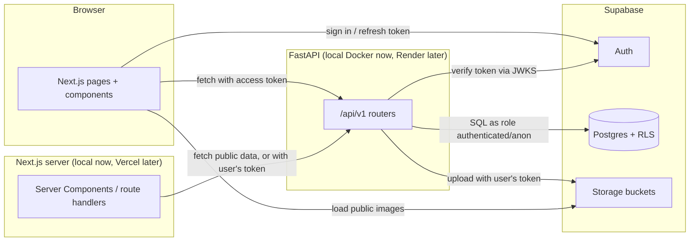
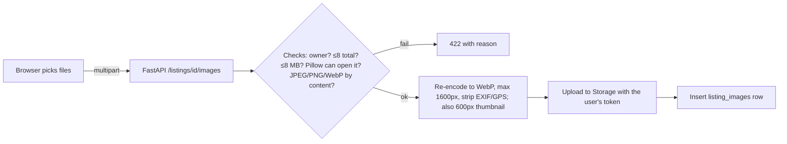

# Architecture

Last updated: 2026-10-10 · Status: Phase 0 draft, awaiting approval

## 1. Big picture
Three parts, one repository, no microservices.



**Why this shape**
- The brief requires FastAPI. Making it the **only** path to app data keeps business rules
  (offer states, blocking, ownership) in one place, in Python, with pytest coverage.
- The browser talks to Supabase only for **Auth** (sign in, refresh) and to **load public images**.
- No Redis, queues, search engines, or Kubernetes. Postgres does search, rate-limit-adjacent
  checks, and state. One developer can hold this in their head.

## 2. Repository layout
```
marketplace/
  frontend/            Next.js App Router (TypeScript strict, Tailwind, ESLint)
    src/app/           routes (see §8)
    src/components/    UI pieces (ListingCard, PriceTag, FilterSheet, ...)
    src/lib/           api client, supabase browser/server clients, formatters
  backend/             FastAPI
    app/main.py        app factory, middleware, exception handlers
    app/core/          config (pydantic-settings), security (JWT), db session, rate limit
    app/api/v1/        routers: health, me, profiles, categories, locations, listings,
                       images, favorites, conversations, offers, reports, blocks
    app/schemas/       Pydantic request/response models
    app/services/      business rules (listing_status.py, offers.py, images.py, ...)
    app/models/        SQLAlchemy table mappings (no migrations here)
    tests/             pytest (unit + integration against local Supabase)
    Dockerfile, pyproject.toml, uv.lock
  supabase/
    config.toml
    migrations/        SQL: tables, indexes, RLS, storage buckets + policies
    seed.sql           categories, PH cities, sample users/listings (fake data)
    tests/             pgTAP RLS tests (optional, see Phase 2)
  docs/
  .github/workflows/ci.yml
  .env.example
```

## 3. Authentication across the three layers

```mermaid
sequenceDiagram
  participant B as Browser (Next.js)
  participant A as Supabase Auth
  participant F as FastAPI
  participant P as Postgres
  B->>A: sign in (email+password or Google)
  A-->>B: access token (JWT, ~1h) + refresh token (stored in cookies by @supabase/ssr)
  B->>F: GET /api/v1/me  Authorization: Bearer <access token>
  F->>F: verify signature with cached JWKS (ES256), check iss, aud, exp; read sub
  F->>P: BEGIN; SET LOCAL ROLE authenticated; set_config('request.jwt.claims', claims, true)
  P->>P: RLS policies use auth.uid() = claims.sub
  P-->>F: only rows this user may see
  F-->>B: JSON (no secrets, no private fields)
```

1. **Supabase Auth** owns passwords and sessions. We never store passwords.
2. **Next.js** uses `@supabase/ssr` so the session lives in cookies and works in Server Components.
   It forwards the access token to FastAPI. It never holds the secret key.
3. **FastAPI** verifies every token itself using Supabase's public keys (JWKS endpoint
   `https://<ref>.supabase.co/auth/v1/.well-known/jwks.json`). It checks signature, `iss`,
   `aud = authenticated`, and `exp`. The user ID is `sub` from the verified token, never from the request body.
   JWKS is cached for at most 10 minutes, matching Supabase's guidance.
4. **Postgres** enforces RLS as a second wall (§4).

Guest requests have no token. FastAPI runs them as the `anon` role, which can only read public data.

> Note: Supabase recommends asymmetric signing keys (ES256) and calls the old shared HS256 secret
> "not recommended". The new project must use asymmetric keys. Locally, `npm run db:keys`
> creates a git-ignored ES256 key (`supabase/signing_keys.json`), so local tokens match production.
> The API rejects HS256 tokens outright.
> Source: https://supabase.com/docs/guides/auth/signing-keys · https://supabase.com/docs/guides/auth/jwts (checked 2026-10-10)

## 4. How FastAPI and RLS work together
**The problem:** if FastAPI connects as `postgres`, RLS is skipped (`postgres` and `service_role`
have BYPASSRLS). One missing `WHERE owner_id = ...` would leak data.

**The design (least privilege, defense in depth):**
- FastAPI connects with a dedicated login role, `api_app`, that has **no** BYPASSRLS and is only
  allowed to switch into `anon` or `authenticated`.
- Each request runs in one transaction:
  `SET LOCAL ROLE authenticated` (or `anon`) and
  `select set_config('request.jwt.claims', '<verified claims JSON>', true)`.
  Supabase's `auth.uid()` reads `sub` from that setting, so the **same RLS policies** apply as if
  the user called Supabase directly. `LOCAL` means the setting ends with the transaction, so
  pooled connections never leak identity between users.
- FastAPI still checks ownership and state rules in Python, so errors are clear (403/404/409)
  and tests cover them. RLS catches anything the Python layer misses.
- **App tables live in a private `app` schema** that is *not* exposed through Supabase's
  auto-generated Data API. Browsers cannot query tables directly even with a valid token.
  RLS stays on anyway.
- The secret (service-role) key is used in exactly one place: deleting the Auth user during
  account deletion (Auth admin API). Documented in `SECURITY_PLAN.md`.
- **Webhooks (Phase 10+)** carry no user. After verifying the signature, the handler runs
  `SET LOCAL ROLE app_integrations`: a NOLOGIN role without BYPASSRLS that may only execute the
  integration functions (`payment_succeeded`, `payment_failed`, `shipment_event`,
  `demo_fast_forward`). Those `security definer` functions do the work. No secret key involved.
- **Money rules live in the database.** Order, payment, ledger, dispute, and admin changes are
  `security definer` functions that check `auth.uid()` / `app.is_admin()`, lock rows, and check
  state; users have read-only grants on those tables. FastAPI checks first for clear errors
  (TRANSACTIONS_DESIGN §1, D6).
- **Payment provider interface** (`app/integrations/`): create a session, verify a signature,
  parse an event. MockPay is the only implementation; a real PH provider would be a second one.

**Verified in Phase 2 (local):** `api_app` is created with `NOINHERIT` and role grants
`WITH INHERIT FALSE, SET TRUE`, so it has no table access until it runs `SET LOCAL ROLE`. A test
proves a query without the switch fails. **Still to verify at deploy time:** that the hosted
Supavisor pooler (session mode) accepts the custom `api_app` login.

Source: https://supabase.com/docs/guides/database/postgres/row-level-security (checked 2026-10-10)

## 5. Database access and migrations
- **Driver:** SQLAlchemy 2 (async) + `asyncpg`. Chosen over psycopg 3 because psycopg's async mode
  does not work with the default Windows event loop. Raw SQL via `text()` for now; easy to read
  next to the RLS policies.
- **Transactions:** one per request, opened by the `Db`/`UserDb` dependency with
  `Depends(scope="function")`, so the commit finishes **before** the response is sent.
- **Migrations:** Supabase CLI SQL files in `supabase/migrations/` are the **single source of truth**.
  RLS policies, storage policies, triggers, and grants are SQL anyway. No Alembic, so there are
  not two migration systems that can disagree.
- **Local:** `supabase start` runs Postgres, Auth, Storage, and Studio in Docker
  (`localhost:54421` API, `54422` DB, `54423` Studio; shifted from the defaults so it can run beside RvFit). `supabase db reset` re-applies migrations + seed.
- **Hosted connection (later):** Supabase direct connections are IPv6-only on free plans. FastAPI
  on Render uses the **shared pooler in session mode** (IPv4, port 5432), which keeps `SET LOCAL`
  and prepared statements working. Transaction mode (6543) is for serverless and is not used.

Sources: https://supabase.com/docs/guides/local-development/cli/getting-started ·
https://supabase.com/docs/guides/database/connecting-to-postgres (checked 2026-10-10)

## 6. Search, filters, pagination
- Postgres full-text search: a generated `tsvector` column on `listings` (title weighted A,
  description B) with a GIN index. `websearch_to_tsquery('simple', q)` handles user input safely.
- Queries also match category names (so "laptop" finds "Laptops & Computers") and partial
  titles via `ILIKE` (wildcards in user input are escaped).
  `simple` config because listings mix English and Filipino.
- `pg_trgm` trigram index on title for partial words and typos ("iphon").
- Filters are indexed columns: `category_id`, `price_centavos`, `condition`, `city_id`, `status`.
- **Search pagination:** page + page_size (max 48), capped at page 50 to keep queries cheap.
  **Chat messages:** cursor (keyset) pagination by `(created_at, id)`.
- Everything is filtered in SQL. The browser never receives the whole table.

## 7. Images

- **Why through the API:** "don't trust the extension" needs a server that reads the real bytes.
  Re-encoding also removes hidden metadata such as **GPS location of the seller's home**.
- **Why our own thumbnails:** Supabase image transformations are Pro-plan only, and Vercel's free
  image optimization allows 5,000 transformations a month. So we create `thumb` and `full` sizes
  once at upload and serve them as static files.
- Bucket `listing-images` is **public-read** (listing photos are public anyway). Writes require a
  token whose user ID matches the first folder of the path (`<user_id>/<listing_id>/<file>.webp`).
- Bucket rules: only `image/webp`, max 2 MB per stored file.
- Built in Phase 4 (`app/services/images.py`, `storage.py`): photos are rotated upright from EXIF
  first, then re-encoded with no EXIF/XMP/ICC. JPEGs larger than needed decode at reduced scale to
  save memory. Files go to `<user_id>/<listing_id>/<random>-full|thumb.webp` using the seller's own
  token plus the public publishable key (no secret key). If the database step fails, the uploaded
  files are removed; deleted photos are removed from Storage after the commit.

Sources: https://supabase.com/docs/guides/storage/security/access-control ·
https://supabase.com/docs/guides/storage/buckets/fundamentals ·
https://supabase.com/docs/guides/storage/serving/image-transformations (checked 2026-10-10)

## 8. Frontend routes
| Route | Access | Notes |
|---|---|---|
| `/` | public | search, categories, recent listings |
| `/search` | public | URL query params for all filters |
| `/categories/[slug]` | public | same results view, category preset |
| `/listing/[id]` | public | details; actions require login |
| `/seller/[username]` | public | username instead of raw ID: nicer URLs, no internal ID exposure |
| `/login`, `/register` | guest | redirect to `?next=` after success |
| `/sell` | signed in | create listing |
| `/my-listings`, `/my-listings/[id]/edit` | signed in, owner | |
| `/favorites`, `/inbox`, `/inbox/[conversationId]` | signed in | |
| `/following` | signed in | Phase 7: sellers you follow + their new listings |
| `/profile`, `/profile/edit`, `/settings` | signed in | |
| `/safety`, `/privacy`, `/terms` | public | safety guidance, privacy notice |
| `/checkout/[listingId]` | signed in | Phase 10: test-mode checkout; `?offer=` uses an accepted offer |
| `/pay/mock/[ref]` | signed in, buyer | Phase 10: MockPay page (simulate success / failure) |
| `/orders`, `/orders/[id]` | signed in, participant | Phases 10–12: orders, tracking, handover, reviews, disputes, test-mode tools |
| `/wallet` | signed in | Phase 10: balance, history, "Demo bank" withdrawal |
| `/admin`, `/admin/reports`, `/admin/disputes`, `/admin/users`, `/admin/log` | signed in; API needs admin role | Phase 12: moderation |

- Route protection runs on the server (Next.js proxy/middleware or layout check). The API checks
  again; the frontend check is only for user experience.
- **Rendering (Phase 3):** pages prerender a static shell; API data is fetched at request time
  inside `<Suspense>` with skeletons (no `use cache`), so builds never need the API and a
  waking Render server shows a skeleton, then `error.tsx` with "Try again" after 20 s.
  Unknown IDs/slugs render `not-found.tsx` (soft 404 with `noindex`, because the page is streamed).
- `next/image` runs with `images.unoptimized: true`; we serve our own WebP thumbnails.
- **Phase 6b:** every page gets security headers and a static CSP from `next.config.ts`
  (SECURITY_PLAN §3c, §7). The root layout adds a "Skip to content" link and a footer linking
  `/safety`, `/terms`, `/privacy`. Client views that load account data show "Try again" on
  failure (`components/ui/load-error.tsx`) and drop that data when hidden.
- Next.js 16.4 is current (released 2026-10-06). A security release is announced for 2026-10-14;
  Phase 1 should pin to that patched version. Source: https://nextjs.org/blog (checked 2026-10-10)

## 9. Messaging
- Messages are rows in Postgres. The open thread polls every ~10 seconds; the inbox polls every
  ~30 seconds while visible; polling stops when the tab is hidden. Built in Phase 5
  (`lib/use-polling.ts`): coming back to a tab polls at once only if a full interval has passed,
  so quick tab switching can't cause bursts. The unread badge polls every 30 seconds.
- Pages stay mounted (hidden) after navigation (Next.js Cache Components + React Activity).
  Forms that hold secrets or one-off input reset themselves after submit (login, register, sell).
- Unread = messages after my `last_read_at` in that conversation.
- Supabase Realtime (free: 200 concurrent connections, 2M messages/month) is a later upgrade.
  It would need extra RLS work on `realtime.messages`, so it is not in the MVP.

## 10. Errors, validation, rate limits
- Pydantic validates every request body and query. Unknown fields are rejected.
- One exception handler turns errors into one shape:
  `{"error": {"code": "listing_not_found", "message": "...", "fields": {...}}}`.
- Resources the user may not see return **404**, not 403, so IDs cannot be probed.
- Rate limits with our own in-process sliding-window limiter (`app/core/ratelimit.py`, Phase 6a;
  no `slowapi` dependency), keyed by user ID or IP. Works because Render free runs a single
  instance. Limits reset when the server restarts; documented as a known limit. Values and the
  `X-Forwarded-For` rule: API_SPECIFICATION §3.
- CORS allows only the frontend origin(s) from config.

## 11. Configuration
`.env` files are per app and never committed. `.env.example` lists names only.

| Variable | Used by | Secret? |
|---|---|---|
| `NEXT_PUBLIC_SUPABASE_URL`, `NEXT_PUBLIC_SUPABASE_PUBLISHABLE_KEY` | frontend | no (public by design) |
| `NEXT_PUBLIC_API_BASE_URL` | frontend | no |
| `SUPABASE_URL`, `SUPABASE_JWKS_URL`, `SUPABASE_JWT_ISSUER` | backend | no |
| `DATABASE_URL` (role `api_app`) | backend | **yes** |
| `SUPABASE_SECRET_KEY` (account deletion only) | backend | **yes** |
| `CORS_ORIGINS`, `ENVIRONMENT` | backend | no |
| `TRUSTED_PROXY_HOPS` (Render: 1), `RATE_LIMITS_ENABLED` | backend | no |

## 12. Testing and CI
- **Backend:** pytest. Unit tests for services and validation. Integration tests run against the
  local Supabase stack with real RLS, using test users created through the local Auth API.
- **Database:** RLS tests that try forbidden reads/writes as other users (pytest, optionally pgTAP).
- **Frontend:** `tsc --noEmit`, ESLint, `next build`; Vitest + Testing Library for forms and key components.
- **CI (GitHub Actions):** Ruff → start local Supabase (CLI in Docker on the runner) → pytest;
  frontend lint/typecheck/build. Uses only local test keys that the CLI prints, never real secrets.

## 13. Decisions log
| # | Decision | Reason |
|---|---|---|
| D1 | FastAPI is the only data path; tables in non-exposed `app` schema | One place for rules; smaller attack surface |
| D2 | RLS via `SET LOCAL ROLE` + JWT claims | Defense in depth without the service key |
| D3 | Supabase SQL migrations only | RLS/storage policies are SQL; avoid two systems |
| D4 | Postgres FTS + pg_trgm | Free, good enough for thousands of listings |
| D5 | Images through API, re-encoded, own thumbnails | Real type checks, EXIF/GPS removal, avoids paid transforms |
| D6 | Polling before Realtime | Simpler, fewer moving parts |
| D7 | Prices as integer centavos | No floating-point errors |
| D8 | `uv` for Python deps with lockfile | Fast, reproducible, free (MIT/Apache-2.0) |
| D9 | `api_app` role with NOINHERIT + SET-only role grants | A missed role switch fails loudly instead of skipping RLS |
| D10 | Guard triggers for state rules (status, offers, read markers) | Rules hold even if API code has a bug; tested directly in SQL |
| D11 | Own in-process rate limiter, not `slowapi` (2026-10-13) | ~100 lines, no new dependency; one instance makes memory enough |
| D12 | Block and report users by username in the API (2026-10-13) | Public responses don't expose user IDs; the server looks the ID up |
