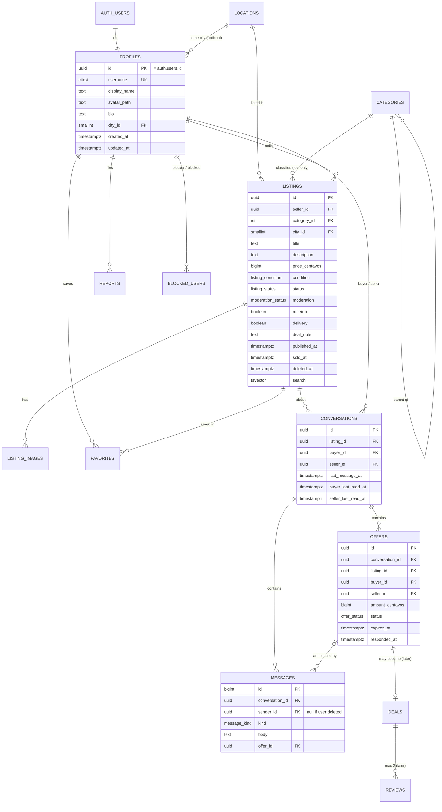

# Database Schema

Last updated: 2026-10-10 · Status: built in Phase 2 — `supabase/migrations/20261010000100..300`. Deals and reviews are still design only.

All app tables live in schema `app` (not exposed by the Supabase Data API). RLS is enabled on
every table. IDs are UUIDs (`gen_random_uuid()`) unless noted. Every table has `created_at`;
editable tables also have `updated_at` (set by a trigger).

## 1. Which tables, and why
| Table | Keep? | Why |
|---|---|---|
| `profiles` | MVP | Public user info, 1:1 with `auth.users` |
| `locations` | MVP | Fixed list of PH regions → cities; consistent filtering instead of free text |
| `categories` | MVP | Two levels via `parent_id` (category → subcategory). One table, not two |
| `listings` | MVP | The item for sale |
| `listing_images` | MVP | 1–8 ordered photos per listing |
| `favorites` | MVP | User ↔ listing join table |
| `conversations` | MVP | One per (listing, buyer). Seller copied in for simple RLS |
| `messages` | MVP | Text, offer events, system notes |
| `offers` | MVP | Own table (not just a message) because it has a state machine |
| `reports` | MVP | Listing or user reports, moderation status |
| `blocked_users` | MVP | Who blocked whom |
| `deals` | Later | The "transactions" entity: a completed deal confirmed by **both** sides |
| `reviews` | Later | One per deal per side |
| admin role | Later | Not a table: `auth.users.app_metadata.role = 'admin'`, set only by SQL/server |

Not needed: separate `subcategories`, `buyers`/`sellers`, `notifications` (unread is computed),
`listing_status_history` (can be added if needed).

## 2. ER diagram

## 3. Enums (explicit status values)
| Type | Values |
|---|---|
| `listing_status` | `draft`, `active`, `paused`, `sold`, `deleted` |
| `moderation_status` | `ok`, `hidden` (set by admin later; hidden listings act like deleted for others) |
| `listing_condition` | `brand_new`, `like_new`, `lightly_used`, `well_used`, `heavily_used` |
| `offer_status` | `pending`, `accepted`, `rejected`, `withdrawn`, `expired` |
| `message_kind` | `text`, `offer`, `system` |
| `report_target` | `listing`, `user` |
| `report_reason` | `prohibited_item`, `scam`, `counterfeit`, `offensive`, `spam`, `other` |
| `report_status` | `open`, `reviewing`, `actioned`, `dismissed` |

## 4. Tables in detail

### profiles
- `id uuid PK references auth.users(id) on delete cascade`
- `username citext unique not null`, check `^[a-z0-9_.]{3,30}$`
- `display_name text` (1–50), `bio text` (≤ 500), `avatar_path text`, `city_id smallint references locations`
- `age_confirmed_at timestamptz` — set at sign-up from the 18+ checkbox; users cannot change it.
- Created by a trigger on `auth.users` insert (security definer, `search_path = ''`), with a random username.
  Email sign-ups without the 18+ confirmation are rejected by that trigger.

### locations
- `id smallint PK`, `region text`, `province text`, `city text`, `slug text unique`
- Seeded with a curated list of major PH cities/municipalities (full PSGC list can be imported later).
- Read-only for everyone.

### categories
- `id int PK`, `parent_id int null references categories`, `slug text unique`, `name text`,
  `sort_order smallint`, `is_active boolean`
- Listings must use a **leaf** category (checked by trigger).
- Read-only for everyone.

### listings
- `seller_id uuid not null references profiles on delete cascade`
- `title text` 3–80 chars; `description text` ≤ 5,000
- `price_centavos bigint` check `0 ≤ x ≤ 10,000,000,000` (₱100M)
- `meetup boolean`, `delivery boolean`, check at least one true; `deal_note text` ≤ 200 (e.g. "SM North, weekends")
- `status listing_status default 'draft'`; `published_at`, `sold_at`, `deleted_at`
- `search tsvector generated always as (setweight(to_tsvector('simple', title),'A') || setweight(to_tsvector('simple', description),'B')) stored`
- Check: `status = 'active'` requires `published_at is not null`.
- **Soft delete:** `status = 'deleted'` + `deleted_at`. Keeps chats and offers meaningful.
  Photos are removed from Storage right away. A later cleanup job may hard-delete after 30 days.

### listing_images
- `listing_id uuid references listings on delete cascade`, `position smallint` 0–7,
  `full_path text`, `thumb_path text`, `width int`, `height int`
- Unique `(listing_id, position)`; max 8 rows per listing (trigger).

### favorites
- PK `(user_id, listing_id)` → duplicates impossible. Both FKs `on delete cascade`.
- Trigger rejects favoriting your own listing.

### conversations
- `listing_id`, `buyer_id`, `seller_id` (copied from listing by trigger, cannot be supplied by the client)
- Unique `(listing_id, buyer_id)`; check `buyer_id <> seller_id`
- `last_message_at`, `buyer_last_read_at`, `seller_last_read_at`
- On user deletion: `buyer_id`/`seller_id` set null; the other person keeps the history.

### messages
- `id bigint generated always as identity` (ordered, compact)
- `sender_id uuid null references profiles on delete set null`
- `kind message_kind`, `body text` 1–2,000 chars (for `text`), `offer_id uuid null`
- Insert-only. No edits or deletes in MVP (keeps an honest record for reports).

### offers
- `amount_centavos bigint` check `> 0` and ≤ listing max
- **Partial unique index:** one `pending` offer per conversation:
  `unique (conversation_id) where status = 'pending'`
- `expires_at = created_at + 7 days`; expired lazily when read and when the listing leaves `active`.
- Transitions enforced in FastAPI **and** in a trigger that rejects illegal changes
  (e.g. `rejected → accepted`). Only the buyer can withdraw; only the seller can accept/reject.

### reports
- `reporter_id`, `target_type`, `listing_id null`, `reported_user_id null`, `reason`, `details` ≤ 1,000, `status`
- Check: exactly one target set and matching `target_type`; cannot report yourself.
- Partial unique: one `open` report per (reporter, target).

### blocked_users
- PK `(blocker_id, blocked_id)`, check `blocker_id <> blocked_id`.

### deals and reviews (later)
- `deals`: `offer_id unique`, `listing_id`, `buyer_id`, `seller_id`, `status` (`awaiting_confirmation`, `completed`, `cancelled`),
  `buyer_confirmed_at`, `seller_confirmed_at`. Completed only when both are set.
- `reviews`: `deal_id`, `reviewer_id`, `reviewee_id`, `rating smallint 1–5`, `comment ≤ 1,000`.
  Unique `(deal_id, reviewer_id)`; check `reviewer_id <> reviewee_id`; insert allowed only when deal is `completed`.

## 5. Indexes
| Index | Serves |
|---|---|
| `listings (status, published_at desc)` | home "recent", sort newest |
| `listings (status, category_id, published_at desc)` | category pages |
| `listings (status, price_centavos)` | price filter/sort |
| `listings (status, city_id)` | location filter |
| `listings using gin (search)` | full-text search |
| `listings using gin (title gin_trgm_ops)` | partial-word search |
| `listings (seller_id, status)` | my listings, seller page, RLS |
| `listing_images (listing_id, position)` | gallery (unique) |
| `favorites (listing_id)` | counts, cascade |
| `conversations (buyer_id, last_message_at desc)`, `(seller_id, last_message_at desc)` | inbox, RLS |
| `messages (conversation_id, id desc)` | thread paging |
| `offers (conversation_id, created_at)`, partial unique pending | history, one pending |
| `reports (status, created_at)` | future moderation queue |
| `blocked_users (blocked_id)` | "am I blocked?" checks |

## 6. RLS policy matrix
`me` = `(select auth.uid())`. All policies are `TO authenticated` unless they say `anon`.
"—" means no policy, so the action is denied.

| Table | SELECT | INSERT | UPDATE | DELETE |
|---|---|---|---|---|
| profiles | anon + auth: all rows, **public columns only** (exposed via a `security_invoker` view or column grants) | trigger only | `id = me` | — (account deletion via Auth admin cascade) |
| locations, categories | anon + auth: all | — | — | — |
| listings | anon + auth: `status in ('active','paused','sold') and moderation = 'ok'`; owner: also own drafts/deleted | `seller_id = me` and status `draft` | `seller_id = me` (USING + WITH CHECK, so ownership cannot change) | — (soft delete is an UPDATE) |
| listing_images | if parent listing is visible | owner of listing | owner | owner |
| favorites | `user_id = me` | `user_id = me` | — | `user_id = me` |
| conversations | `me in (buyer_id, seller_id)` | `buyer_id = me`, listing active, not own, not blocked | participant (read markers only, via column grants) | — |
| messages | participant of conversation | `sender_id = me` and participant and not blocked | — | — |
| offers | participant | `buyer_id = me`, listing active | buyer: pending→withdrawn; seller: pending→accepted/rejected (plus trigger) | — |
| reports | `reporter_id = me` | `reporter_id = me` | — | — |
| blocked_users | `blocker_id = me` | `blocker_id = me` | — | `blocker_id = me` |

Storage (`storage.objects`, bucket `listing-images` and `avatars`): public read; INSERT/UPDATE/DELETE
only when `(storage.foldername(name))[1] = me::text`.

Notes:
- `auth.uid()` is wrapped in `(select ...)` and policies name their role, per Supabase performance guidance.
- Helper functions (e.g. `app.is_participant(conversation_id)`, `app.is_blocked(a, b)`) are
  `security definer` with `search_path = ''`, in a schema the API cannot call directly.
- Default grants to `anon`/`authenticated` are revoked first, then only the needed grants are added,
  in the same migration as the policies.

Source: https://supabase.com/docs/guides/database/postgres/row-level-security (checked 2026-10-10)

## 7. Deletion and archival rules
| Event | Effect |
|---|---|
| Seller deletes listing | `status = deleted`, `deleted_at` set; images removed from Storage; favorites stay but show "no longer available"; pending offers → expired; chats stay readable |
| Listing marked sold | pending offers → expired; new offers blocked; chat continues |
| User deletes account | Auth user deleted → profile cascade → listings (and the chats/offers about them), images, favorites, blocks, own reports deleted. Chats where they were the buyer stay for the seller with `buyer_id`/`sender_id` set null ("Deleted user"). Reports about them keep the row with the target set null. Tested in `test_account_deletion.py` |
| Admin hides listing (later) | `moderation = hidden`; only owner sees it, with a notice |

## 8. Seed data (local only)
- ~25 categories in 2 levels (e.g. Electronics → Mobile Phones, Laptops; Fashion → Women's, Men's, Shoes; Home & Living; Hobbies & Toys; Sports; Baby & Kids; Books; Vehicles accessories).
- ~80 PH cities across Luzon, Visayas, Mindanao.
- 6 fake users (`seller1@example.test` etc.) created through the local Auth API, ~60 listings with
  realistic PHP prices, Filipino/English titles, and **locally generated placeholder images**
  (simple drawn product silhouettes or solid-color cards). No scraped photos.
- Seed never runs against a hosted project.
