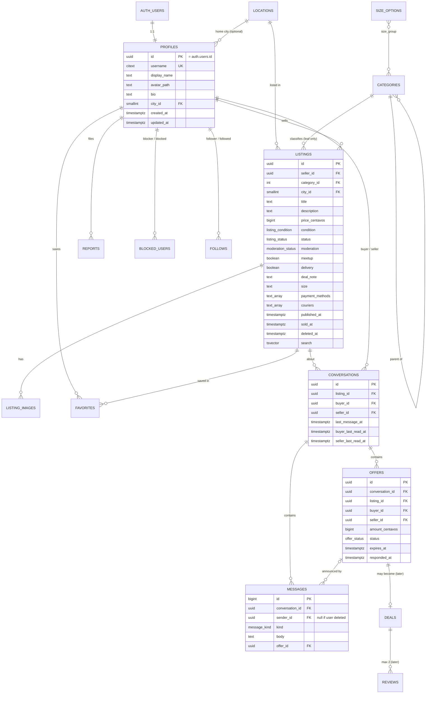

# Database Schema

Last updated: 2026-10-13 · Status: built in Phase 2 — `supabase/migrations/20261010000100..300`; later phases added migrations up to `20261013000300` (Phase 7: sizes, deal options, follows). Phases 10–12 add orders, payments, ledger, shipments, reviews, disputes, and admin (§9; design in `TRANSACTIONS_DESIGN.md`), built in migrations `20261013000400`–`20261013000700`.

All app tables live in schema `app` (not exposed by the Supabase Data API). RLS is enabled on
every table. IDs are UUIDs (`gen_random_uuid()`) unless noted. Every table has `created_at`;
editable tables also have `updated_at` (set by a trigger).

## 1. Which tables, and why
| Table | Keep? | Why |
|---|---|---|
| `profiles` | MVP | Public user info, 1:1 with `auth.users` |
| `locations` | MVP | Fixed list of PH regions → cities; consistent filtering instead of free text |
| `categories` | MVP | Two levels via `parent_id` (category → subcategory). One table, not two |
| `listings` | MVP | The item for sale |
| `listing_images` | MVP | 1–8 ordered photos per listing |
| `favorites` | MVP | User ↔ listing join table |
| `conversations` | MVP | One per (listing, buyer). Seller copied in for simple RLS |
| `messages` | MVP | Text, offer events, system notes |
| `offers` | MVP | Own table (not just a message) because it has a state machine |
| `reports` | MVP | Listing or user reports, moderation status |
| `blocked_users` | MVP | Who blocked whom |
| `size_options` | Phase 7 | Fixed size lists (clothing, shoes, kids); reference data |
| `follows` | Phase 7 | Who follows which seller; private to the follower |
| `orders` | Phase 10 | One buyer buying one listing (meetup/delivery × online/cash/COD); replaces the planned `deals` table |
| `order_secrets` | Phase 10 | Meetup handover code; readable only by the buyer |
| `payments`, `provider_events` | Phase 10 | Simulated provider sessions; processed webhook IDs (idempotency) |
| `ledger_entries` | Phase 10 | Append-only double-entry money record; wallet balances are sums |
| `shipments`, `shipment_events` | Phase 11 | Fake waybill and tracking steps |
| `reviews` | Phase 11 | One per completed order per side |
| `disputes` | Phase 12 | One per online order |
| `admin_actions` | Phase 12 | Audit log of every admin action |
| admin role | Phase 12 | Not a table: `auth.users.app_metadata.role = 'admin'`, set only by SQL/server |

Not needed: separate `subcategories`, `buyers`/`sellers`, `notifications` (unread is computed),
`listing_status_history` (can be added if needed).

## 2. ER diagram

## 3. Enums (explicit status values)
| Type | Values |
|---|---|
| `listing_status` | `draft`, `active`, `paused`, `sold`, `deleted`, `reserved` (Phase 10; only order functions set or clear it) |
| `moderation_status` | `ok`, `hidden` (set by admin later; hidden listings act like deleted for others) |
| `listing_condition` | `brand_new`, `like_new`, `lightly_used`, `well_used`, `heavily_used` |
| `offer_status` | `pending`, `accepted`, `rejected`, `withdrawn`, `expired` |
| `message_kind` | `text`, `offer`, `system` |
| `report_target` | `listing`, `user` |
| `report_reason` | `prohibited_item`, `scam`, `counterfeit`, `offensive`, `spam`, `other` |
| `report_status` | `open`, `reviewing`, `actioned`, `dismissed` |

## 4. Tables in detail

### profiles
- `id uuid PK references auth.users(id) on delete cascade`
- `username citext unique not null`, check `^[a-z0-9_.]{3,30}$`
- `display_name text` (1–50), `bio text` (≤ 500), `avatar_path text`, `city_id smallint references locations`
- `age_confirmed_at timestamptz` — set at sign-up from the 18+ checkbox; users cannot change it.
- Created by a trigger on `auth.users` insert (security definer, `search_path = ''`), with a random username.
  Email sign-ups without the 18+ confirmation are rejected by that trigger.

### locations
- `id smallint PK`, `region text`, `province text`, `city text`, `slug text unique`
- Seeded with a curated list of major PH cities/municipalities (full PSGC list can be imported later).
- Read-only for everyone.

### categories
- `id int PK`, `parent_id int null references categories`, `slug text unique`, `name text`,
  `sort_order smallint`, `is_active boolean`
- Listings must use a **leaf** category (checked by trigger).
- `size_group text null` (Phase 7): `clothing`, `shoes`, `kids`, or null (no sizes). Set in `seed.sql`.
- Read-only for everyone.

### listings
- `seller_id uuid not null references profiles on delete cascade`
- `title text` 3–80 chars; `description text` ≤ 5,000
- `price_centavos bigint` check `0 ≤ x ≤ 10,000,000,000` (₱100M)
- `meetup boolean`, `delivery boolean`, check at least one true; `deal_note text` ≤ 200 (e.g. "SM North, weekends")
- `status listing_status default 'draft'`; `published_at`, `sold_at`, `deleted_at`
- `search tsvector generated always as (setweight(to_tsvector('simple', title),'A') || setweight(to_tsvector('simple', description),'B')) stored`
- Check: `status = 'active'` requires `published_at is not null`.
- Phase 7: `size text null` must be on the category's `size_options` list (trigger
  `listings_size_check`). `payment_methods text[]` ⊆ {gcash, maya, bank_transfer, cash, cod} and
  `couriers text[]` ⊆ {jnt, flash, lbc, lalamove, grab}, no duplicates (`app.array_is_distinct`).
  Checks: couriers and `cod` need `delivery`; `cash` needs `meetup`. Labels only (no payments).
- **Soft delete:** `status = 'deleted'` + `deleted_at`. Keeps chats and offers meaningful.
  Photos are removed from Storage right away. A later cleanup job may hard-delete after 30 days.

### listing_images
- `listing_id uuid references listings on delete cascade`, `position smallint` 0–7,
  `full_path text`, `thumb_path text`, `width int`, `height int`
- Unique `(listing_id, position)`; max 8 rows per listing (trigger).
- An **active** listing cannot lose its last photo (trigger `listing_images_keep_one`, migration
  `20261013000100`). Draft, paused, and sold listings may; publishing or resuming checks again.

### favorites
- PK `(user_id, listing_id)` → duplicates impossible. Both FKs `on delete cascade`.
- Trigger rejects favoriting your own listing.

### conversations
- `listing_id`, `buyer_id`, `seller_id` (copied from listing by trigger, cannot be supplied by the client)
- Unique `(listing_id, buyer_id)`; check `buyer_id <> seller_id`
- `last_message_at`, `buyer_last_read_at`, `seller_last_read_at`
- On user deletion: `buyer_id`/`seller_id` set null; the other person keeps the history.

### messages
- `id bigint generated always as identity` (ordered, compact)
- `sender_id uuid null references profiles on delete set null`
- `kind message_kind`, `body text` 1–2,000 chars (for `text`), `offer_id uuid null`
- Insert-only. No edits or deletes in MVP (keeps an honest record for reports).

### offers
- `amount_centavos bigint` check `> 0` and ≤ listing max
- **Partial unique index:** one `pending` offer per conversation:
  `unique (conversation_id) where status = 'pending'`
- `expires_at = created_at + 7 days`; expired lazily when read and when the listing leaves `active`.
  Lazy expiry uses `app.expire_stale_offers(conversation)` (security definer, migration
  `20261013000200`): users may not set "expired" themselves, so a definer function does it, only
  for past-due offers in a chat the caller is part of.
- Fixed in Phase 5: the "other user has left" rule only stops typed messages. Before, an automatic
  "Offer expired" note failed when the buyer had deleted their account, which blocked the seller
  from marking the item sold. Regression test in `test_api_social.py`.
- Transitions enforced in FastAPI **and** in a trigger that rejects illegal changes
  (e.g. `rejected → accepted`). Only the buyer can withdraw; only the seller can accept/reject.

### reports
- `reporter_id`, `target_type`, `listing_id null`, `reported_user_id null`, `reason`, `details` ≤ 1,000, `status`
- Check: exactly one target set and matching `target_type`; cannot report yourself.
- Partial unique: one `open` report per (reporter, target).

### blocked_users
- PK `(blocker_id, blocked_id)`, check `blocker_id <> blocked_id`.

### size_options (Phase 7)
- PK `(size_group, value)`, `sort_order`. Clothing XXS–4XL + Free size; shoes EU 35–47;
  kids 0-6 months … 13-14 years. Read-only for everyone.

### follows (Phase 7)
- PK `(follower_id, followed_id)`, both FKs `on delete cascade`; check not self; `created_at` set by trigger.
- Trigger `follows_guard`: no follow across a block (either side, `42501`); max 1,000 per follower.
- Trigger `blocks_end_follows` (definer) on `blocked_users` insert: deletes follows both ways.
- `app.follower_count(profile)` (definer, stable): public count without exposing who follows.

### deals and reviews
Replaced by `orders` and `reviews` (§9). A cash meetup is an order with `payment_method = cash`,
completed by the handover code, so "both sides confirmed" is no longer needed.

## 5. Indexes
| Index | Serves |
|---|---|
| `listings (status, published_at desc)` | home "recent", sort newest |
| `listings (status, category_id, published_at desc)` | category pages |
| `listings (status, price_centavos)` | price filter/sort |
| `listings (status, city_id)` | location filter |
| `listings using gin (search)` | full-text search |
| `listings using gin (title gin_trgm_ops)` | partial-word search |
| `listings (seller_id, status)` | my listings, seller page, RLS |
| `listing_images (listing_id, position)` | gallery (unique) |
| `favorites (listing_id)` | counts, cascade |
| `conversations (buyer_id, last_message_at desc)`, `(seller_id, last_message_at desc)` | inbox, RLS |
| `messages (conversation_id, id desc)` | thread paging |
| `offers (conversation_id, created_at)`, partial unique pending | history, one pending |
| `reports (status, created_at)` | future moderation queue |
| `blocked_users (blocked_id)` | "am I blocked?" checks |
| `listings (category_id, size) where size is not null` | size filter |
| `follows (followed_id)` | follower counts, cascade (the PK serves the feed) |

## 6. RLS policy matrix
`me` = `(select auth.uid())`. All policies are `TO authenticated` unless they say `anon`.
"—" means no policy, so the action is denied.

| Table | SELECT | INSERT | UPDATE | DELETE |
|---|---|---|---|---|
| profiles | anon + auth: all rows, **public columns only** (exposed via a `security_invoker` view or column grants) | trigger only | `id = me` | — (account deletion via Auth admin cascade) |
| locations, categories | anon + auth: all | — | — | — |
| listings | anon + auth: `status in ('active','paused','sold') and moderation = 'ok'`; owner: also own drafts/deleted | `seller_id = me` and status `draft` | `seller_id = me` (USING + WITH CHECK, so ownership cannot change) | — (soft delete is an UPDATE) |
| listing_images | if parent listing is visible | owner of listing | owner | owner |
| favorites | `user_id = me` | `user_id = me` | — | `user_id = me` |
| conversations | `me in (buyer_id, seller_id)` | `buyer_id = me`, listing active, not own, not blocked | participant (read markers only, via column grants) | — |
| messages | participant of conversation | `sender_id = me` and participant and not blocked | — | — |
| offers | participant | `buyer_id = me`, listing active | buyer: pending→withdrawn; seller: pending→accepted/rejected (plus trigger) | — |
| reports | `reporter_id = me` | `reporter_id = me` | — | — |
| blocked_users | `blocker_id = me` | `blocker_id = me` | — | `blocker_id = me` |
| size_options | anon + auth: all | — | — | — |
| follows | `follower_id = me` | `follower_id = me` (+ guard trigger) | — | `follower_id = me` |

Storage (`storage.objects`, bucket `listing-images` and `avatars`): public read; INSERT/UPDATE/DELETE
only when `(storage.foldername(name))[1] = me::text`.

Notes:
- `auth.uid()` is wrapped in `(select ...)` and policies name their role, per Supabase performance guidance.
- Helper functions (e.g. `app.is_participant(conversation_id)`, `app.is_blocked(a, b)`) are
  `security definer` with `search_path = ''`, in a schema the API cannot call directly.
- Default grants to `anon`/`authenticated` are revoked first, then only the needed grants are added,
  in the same migration as the policies.

Source: https://supabase.com/docs/guides/database/postgres/row-level-security (checked 2026-10-10)

## 7. Deletion and archival rules
| Event | Effect |
|---|---|
| Seller deletes listing | `status = deleted`, `deleted_at` set; images removed from Storage; favorites rows stay but the listing is no longer visible, so it drops out of Saved items; pending offers → expired; chats stay readable |
| Listing marked sold | pending offers → expired; new offers blocked; chat continues |
| User deletes account | Auth user deleted → profile cascade → listings (and the chats/offers about them), images, favorites, blocks, follows (both directions), own reports deleted. Chats where they were the buyer stay for the seller with `buyer_id`/`sender_id` set null ("Deleted user"). Reports about them keep the row with the target set null. Tested in `test_account_deletion.py` |
| Admin hides listing (later) | `moderation = hidden`; only owner sees it, with a notice |

## 8. Seed data (local only)
- ~25 categories in 2 levels (e.g. Electronics → Mobile Phones, Laptops; Fashion → Women's, Men's, Shoes; Home & Living; Hobbies & Toys; Sports; Baby & Kids; Books; Vehicles accessories).
- ~80 PH cities across Luzon, Visayas, Mindanao.
- 6 fake users (`seller1@example.test` etc.) created through the local Auth API, ~60 listings with
  realistic PHP prices, Filipino/English titles, and **locally generated placeholder images**
  (simple drawn product silhouettes or solid-color cards). No scraped photos.
- Seed never runs against a hosted project.

## 9. Transactions (Phases 10–12)
Design and state machine: `TRANSACTIONS_DESIGN.md`. All tables in `app`, RLS on, **no insert,
update, or delete grants to users**: every change goes through a `security definer` function
that checks `auth.uid()`, locks the rows it changes (`for update`), and checks the state.

### Enums
| Type | Values |
|---|---|
| `order_status` | `pending_payment`, `confirmed`, `shipped`, `delivered`, `completed`, `cancelled`, `disputed`, `refunded` |
| `order_fulfilment` | `meetup`, `delivery` |
| `order_payment` | `online`, `cash`, `cod` |
| `payment_status` | `pending`, `succeeded`, `failed` |
| `shipment_status` | `label_created`, `picked_up`, `in_transit`, `out_for_delivery`, `delivered` |
| `ledger_account` | `external`, `escrow`, `seller`, `courier`, `platform` |
| `dispute_reason` | `not_received`, `not_as_described`, `incomplete` |
| `dispute_status` | `open`, `escalated`, `resolved` |

### orders
- `listing_id` (on delete set null), `buyer_id`, `seller_id` (profiles, on delete set null),
  `offer_id null`, snapshots `title`, `cover_path`, and (Phase 14) `description`, `condition`
  (what the listing said when it was bought; null for older orders)
- `fulfilment`, `payment_method`, `courier null` (same five codes as listings)
- `item_price_centavos`, `shipping_fee_centavos`, `buyer_fee_centavos`, `total_centavos`
  (check total = sum; all ≥ 0)
- `status`, `cancel_reason null` (`buyer`, `seller`, `payment_expired`, `not_shipped`, `not_met`)
- Times: `created_at`, `updated_at`, `paid_at`, `shipped_at`, `delivered_at`, `completed_at`,
  `cancelled_at`, `refunded_at`; deadlines `payment_due_at`, `ship_by`, `meet_by`, `confirm_by`
- Checks: delivery ⇔ courier set; cash ⇒ meetup; COD ⇒ delivery; buyer ≠ seller (on insert)
- Partial unique index: one open order per listing
  (`status in ('pending_payment','confirmed','shipped','delivered','disputed')`)
- Indexes: `(buyer_id, created_at desc)`, `(seller_id, created_at desc)`, `(status)`

### order_secrets
`order_id PK`, `handover_code text` (6 digits), `attempts smallint`, `created_at`.
RLS: select only when the caller is the order's buyer.

### payments and provider_events
- `payments`: `order_id`, `provider` (`mock`), `provider_ref unique`, `amount_centavos`, `status`,
  `created_at`, `updated_at`. Partial unique: one `succeeded` payment per order.
- `provider_events`: PK `(provider, event_id)`, `kind`, `received_at`. Insert-once = idempotency.

### ledger_entries
`id bigint identity`, `txn_id uuid`, `order_id null`, `account`, `user_id null`,
`amount_centavos bigint <> 0`, `memo`, `created_at`. Checks: `seller`/`external` need `user_id`;
`escrow`/`courier`/`platform` have none. Deferred constraint trigger: each `txn_id` sums to 0.
Update/delete refused by trigger. Wallet = `sum(amount) where account='seller' and user_id=me`.

### shipments and shipment_events (Phase 11)
`shipments`: `order_id PK`, `courier`, `tracking_number unique`, `status`, `created_at`,
`updated_at`. `shipment_events`: `id`, `order_id`, `status`, `created_at`. Status only moves forward.

### reviews (Phase 11)
`order_id`, `reviewer_id` (set null on delete), `reviewee_id` (cascade), `rating 1–5`,
`comment ≤ 1,000`, `created_at`. Unique `(order_id, reviewer_id)`. Public when both sides reviewed
or 14 days after completion (`app.review_is_public`). Phase 14: public lists and the rating
average count only the latest review per reviewer–reviewee pair (`app.public_reviews`).

### disputes (Phase 12)
`id`, `order_id unique`, `reason`, `details ≤ 1,000`, `status`, `respond_by`, `seller_note`,
`admin_note`, `outcome null` (`refunded`, `released`, `withdrawn`), `created_at`, `resolved_at`.
Phase 14: `opened_by` (`buyer` | `seller`; the seller's reason is `taken_without_code`) and
`decide_by` (set by a trigger to 14 days after a dispute becomes `escalated`; once it passes,
the next read refunds the buyer).

### admin_actions (Phase 12)
`id bigint identity`, `admin_id` (set null on delete), `action`, `target_type`, `target_id`,
`note ≤ 500`, `created_at`. Insert only inside admin functions.

### profiles (Phase 12)
`restricted_at timestamptz null` (public; set only by admin functions; users cannot change it).

### RLS (reads only; writes are definer functions)
| Table | SELECT |
|---|---|
| orders, payments, shipments, shipment_events, disputes | buyer or seller of the order; admin |
| order_secrets | buyer of the order |
| ledger_entries | `user_id = me`; admin |
| provider_events | nobody (definer functions only) |
| reviews | reviewer; everyone when public |
| admin_actions | admin |
| reports, listings (all statuses) | admin, in addition to the earlier policies |

### Roles
- `app_integrations` (NOLOGIN, no BYPASSRLS): granted to `api_app` with `SET` only; may only
  execute `app.payment_succeeded`, `app.payment_failed`, `app.shipment_event`, and
  `app.demo_fast_forward`. Used by webhook handlers and demo tools (TRANSACTIONS_DESIGN §5, §11).
