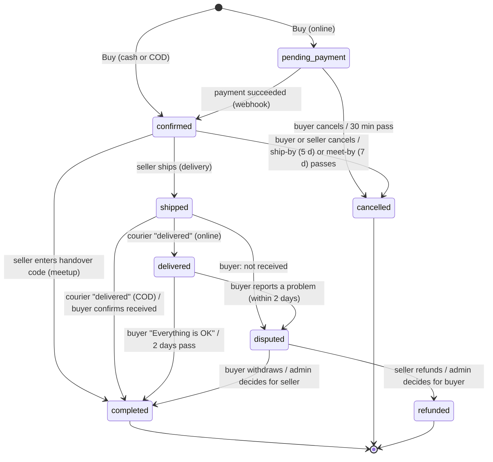

# Transactions Design (orders, simulated payments, fulfilment, disputes)

Last updated: 2026-10-13 · Status: Phase 9 design. Built in Phases 10–12.
Research behind it: `docs/research/TRANSACTIONS_RESEARCH.md`.

> **Test mode only.** Every payment, payout, shipping label, and tracking update in this app is
> simulated. No real money moves, no card or bank details are ever asked for, and no courier is
> contacted. Every page that shows money says so.

## 1. Decisions (approved 2026-10-13)
| # | Decision | Why |
|---|---|---|
| D1 | Built-in **mock provider** ("MockPay"), behind a provider interface | ₱0, works offline and in CI. A real PH provider (e.g. PayMongo test mode) can be added later without changing orders or the ledger |
| D2 | Include simulated **COD** | Common in PH; shows a second money path (courier remits to the seller) |
| D3 | Buyer fee **₱15 + 5%** of the item price on online payments; seller fee ₱0 | Mirrors Vinted's model; demo numbers only |
| D4 | Keep chat deals (Phases 5–7) unchanged; orders are an extra "Buy" path | Carousell PH style stays; the protected checkout is an add-on |
| D5 | Timers are **lazy** (checked when someone reads an order), like `expire_stale_offers` | No background workers on the free plan |
| D6 | Money rules live in **Postgres `security definer` functions**; users get no write grants on order/payment/ledger tables | One place enforces state, amounts, and locks; RLS still limits reads |
| D7 | Webhooks run as a new role **`app_integrations`** (execute-only on integration functions) | No user identity on a webhook; no BYPASSRLS; no secret key |
| D8 | Admin = `app_metadata.role = 'admin'` in the verified token; every admin action goes through a definer function that writes an audit row | Users can't edit `app_metadata`; actions are traceable |
| D9 | Out of scope: returns, partial refunds, KYC, real labels, lockers, BNPL, chat link-blocking | Keeps Phases 10–12 small; listed in KNOWN_LIMITATIONS |

## 2. Order types
An order is one buyer buying one listing. Price = the listing price, or the buyer's own
**accepted offer** on that listing (offer ID is passed; amount is read from the database).

| Fulfilment | Payment | Money held in app? | Completes when | Buyer protection |
|---|---|---|---|---|
| Meetup | Online (MockPay) | Yes (escrow) | Seller enters the buyer's **handover code** | Yes: the buyer gives the code only after inspecting |
| Meetup | Cash | No | Seller enters the handover code | No (records the deal; unlocks reviews) |
| Delivery | Online (MockPay) | Yes (escrow) | Buyer taps "Everything is OK", or 2 days after delivery | Yes: dispute window |
| Delivery | COD | No (courier collects) | Courier marks delivered → courier remits to seller | No |

Allowed options come from the listing: meetup/delivery flags; cash only if the listing accepts
`cash`; COD only if it accepts `cod`; online is always offered. A delivery order needs a courier;
if the listing names couriers, it must be one of them, otherwise any of the five.

## 3. Amounts (all integer centavos, computed by the database)
- `item_price` = listing price or accepted offer amount.
- `shipping_fee` (delivery only, demo flat rates): J&T ₱120, Flash ₱110, LBC ₱180, Lalamove ₱250,
  Grab ₱250. Meetup: ₱0.
- `buyer_fee` (online only) = 1,500 + round(item_price × 5 / 100), rounded half up to the centavo.
  Cash and COD: ₱0.
- `total` = item_price + shipping_fee + buyer_fee. Requests never carry amounts (unknown fields → 422).

## 4. Order state machine

- **Listing effects:** creating an order sets the listing to **`reserved`** (new status; no new
  chats, offers, or orders; pending offers expire as when it leaves `active`). `completed` → listing
  `sold`. `cancelled`/`refunded` → listing back to `active` (if still reserved).
  Only order functions move a listing into or out of `reserved`.
- **Cancel rules:** buyer may cancel in `pending_payment` or `confirmed`; seller may cancel in
  `confirmed`. Cancelling a paid order refunds it in full (item, shipping, fee).
- **Late payment:** a payment that succeeds after its order was cancelled is captured and refunded
  at once (recorded in the ledger), never silently kept.
- One open order per listing (partial unique index + listing row lock).

### Timers (lazy, D5)
| Timer | Length | On expiry |
|---|---|---|
| `payment_due_at` | 30 min after order | cancelled (`payment_expired`) |
| `ship_by` | 5 days after confirmed (delivery) | cancelled (`not_shipped`) + refund |
| `meet_by` | 7 days after confirmed (meetup) | cancelled (`not_met`) + refund |
| `confirm_by` | 2 days after delivered (online delivery) | completed + release |
| dispute `respond_by` | 48 h after a dispute opens | escalated to admin |
| review window | 30 days after completed | no new reviews |
| review blind period | until both review, or 14 days after completed | reviews become public |

`app.order_tick(order)` applies due timers; the API calls it before every order read or action,
and `app.orders_tick_mine()` before lists. Creating an order first expires stale
`pending_payment` orders on that listing.

## 5. Payments (MockPay) and webhooks
```mermaid
sequenceDiagram
  actor Buyer
  participant Web as Next.js
  participant API as FastAPI
  participant Mock as MockPay (app/integrations)
  participant DB as Postgres
  Buyer->>API: POST /orders/{id}/pay
  API->>Mock: create session(order, total)
  API->>DB: app.payment_start(order, 'mock', ref) — amount = order total
  API-->>Web: checkout_url = /pay/mock/{ref}
  Buyer->>Web: MockPay page: "Simulate success" / "Simulate failure"
  Web->>API: POST /mock-pay/sessions/{ref}/complete {outcome}
  API->>Mock: build event {id, type, ref, amount}; sign HMAC-SHA256(t.body)
  Mock->>API: deliver to webhook handler (same code as POST /payments/webhooks/mock)
  API->>API: verify signature, 5-min timestamp tolerance
  API->>DB: SET LOCAL ROLE app_integrations; app.payment_succeeded(event_id, ref, amount)
  DB-->>DB: idempotent (provider_events), amount check, order → confirmed, ledger capture
```
- Signature header: `MockPay-Signature: t=<unix>,v1=<hex HMAC-SHA256 of "t.body">` with
  `MOCKPAY_WEBHOOK_SECRET`. Compared in constant time. Same scheme for the mock courier
  (`MockCourier-Signature`, `MOCKCOURIER_WEBHOOK_SECRET`).
- A duplicate event ID returns 200 and changes nothing. A wrong amount marks the payment `failed`.
- The MockPay page never shows card or bank fields; it says "Test mode — no real money".

## 6. Ledger and wallet (double entry, append-only)
`ledger_entries` rows belong to a transaction (`txn_id`); each transaction sums to **zero**
(deferred constraint trigger). No user can insert, update, or delete rows (no grants + a trigger).

| Event | Entries |
|---|---|
| Online payment captured | external(buyer) −total · escrow +total |
| Release (online order completed) | escrow −total · seller(seller) +item · courier +shipping · platform +fee |
| Refund (cancel paid order, dispute for buyer) | escrow −total · external(buyer) +total |
| COD delivered (courier remits) | external(buyer) −(item+shipping) · courier +shipping · seller(seller) +item |
| Withdrawal | seller(user) −amount · external(user) +amount |

- **Available balance** = sum of the user's `seller` entries. **Pending** = item prices of the
  user's open online sales (money in escrow).
- Withdrawal: ₱100 minimum, at most the available balance, to "Demo bank" (no account details).
  Locked per user so two withdrawals can't overdraw.
- Cash meetups write no ledger rows (money is outside the app).

## 7. Fulfilment
- **Delivery:** seller taps "Ship" in `confirmed` → a shipment with a fake waybill
  (`DEMO-JNT-1234567890`) → order `shipped`. Courier steps: `label_created → picked_up →
  in_transit → out_for_delivery → delivered`, only forward. In test mode a participant can press
  "Advance tracking (demo)", which sends a signed MockCourier event to the shipping webhook.
- **Meetup handover code:** 6 random digits, stored in `order_secrets`, readable only by the
  buyer. The seller enters it; 5 wrong tries lock it until the buyer makes a new code.
- **Demo fast-forward:** in test mode a participant can "Skip ahead" on an order, which moves its
  current deadline to now so the next read applies the timer. Lets a reviewer see auto-release,
  auto-cancel, and escalation without waiting days.

## 8. Disputes (online orders only)
1. Buyer opens: `not_received` (while `shipped`), `not_as_described` or `incomplete` (while
   `delivered`, before `confirm_by`). Order → `disputed`; seller has 48 h.
2. Seller: **Refund** (→ order `refunded`, money back to the buyer) or **Contest** (→ escalated).
3. Buyer may **withdraw** (→ order `completed`, money released) or **escalate** at any time.
4. No seller answer in 48 h → escalated (lazy timer).
5. Admin decides **refund buyer** or **release to seller**, with a note. Final.
No returns or partial refunds (D9).

## 9. Reviews
One review per side per **completed** order (any payment type), 1–5 stars + optional comment
≤ 1,000 chars, within 30 days. Double-blind: hidden from the other side and the public until both
have reviewed or 14 days passed. The reviewer always sees their own. Seller pages show the average
and count of public reviews.

## 10. Admin moderation (Phase 12)
- Admin = `app_metadata.role = 'admin'` in the verified token (`app.is_admin()` reads
  `auth.jwt()`); set locally by `npm run db:admin -- <email>`; the user signs in again to get it.
- Screens: summary counts; reports queue (dismiss / action, hide listing, restrict user);
  disputes queue (refund buyer / release seller); users (restrict / unrestrict); audit log.
- **Restricted users** can still read and finish existing orders, but cannot create listings,
  chats, messages, offers, or orders. Chat shows "This account is restricted" to the other side.
- Every admin action runs in a definer function that checks `app.is_admin()` and inserts an
  `admin_actions` row in the same transaction.

## 11. Test-mode tools
`DEMO_TOOLS_ENABLED` (default `true` locally and in tests; must be set explicitly in production)
mounts the MockPay complete route, "Advance tracking", and "Skip ahead". With it off, those routes
don't exist (404). The "Test mode" banner shows whenever the payment provider is MockPay.

## 12. Account deletion
Refused (409) while the user has an open order (buyer or seller) or a wallet balance above ₱0
("withdraw first"). A database trigger is the second wall. Finished orders keep their history with
the deleted side shown as "Deleted user".
