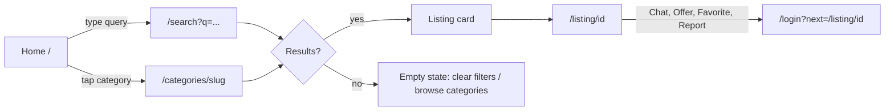
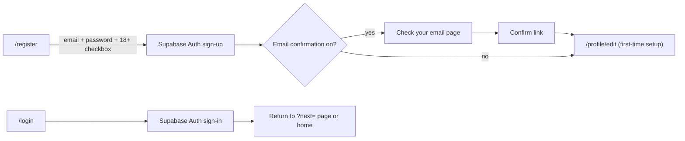
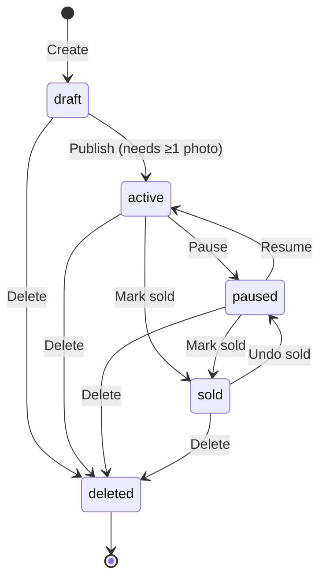
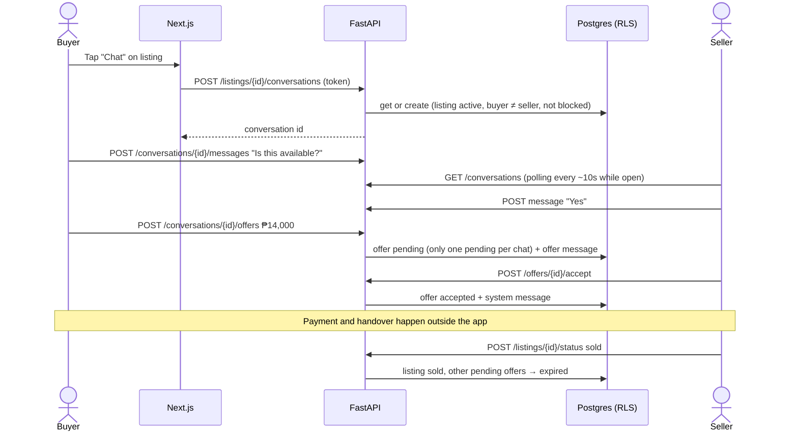
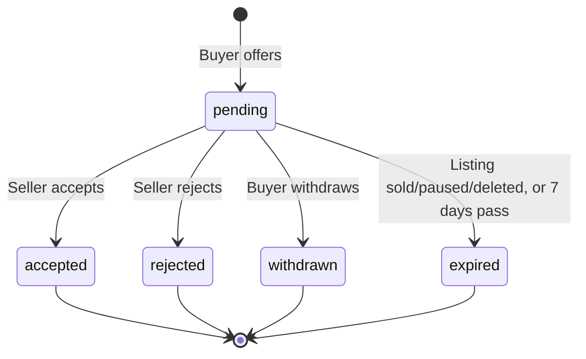
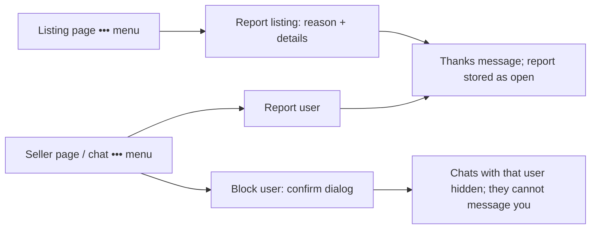

# User Flows

Last updated: 2026-10-10 · Status: Phase 0 draft

These flows are **our design**. Where they mirror Carousell, the observed source is in
`PRODUCT_REQUIREMENTS.md` §2.

## 1. Guest discovers an item

- Filters live in the URL: `q, category, min_price, max_price, condition, city, sort, page`.
  Sharing or refreshing the URL keeps the results.
- Mobile: filters open in a full-screen sheet; desktop: a sidebar.
- If the API is waking up (Render free tier), show a "Starting up, one moment…" state with retry.

## 2. Register and log in

- First login creates a `profiles` row (database trigger) with a generated username the user can change.
- Errors shown in plain words: wrong password, email not confirmed, too many attempts.
- `?next=` only accepts same-site relative paths (prevents open redirects).

## 3. Seller creates and manages a listing

Steps on `/sell`:
1. Photos first (1–8; JPEG/PNG/WebP; "move earlier/later" buttons instead of drag and drop, so
   touch, keyboard, and screen readers work the same; first photo is the cover).
2. Title, category → subcategory, condition, price, city, description, meetup or delivery note.
3. Save draft or Publish. Validation errors appear next to each field.

`/my-listings` tabs: Active · Paused · Sold · Drafts. Each card has Edit, Pause/Resume,
Mark sold, Delete. Delete and Mark sold ask for confirmation.

## 4. Buyer contacts seller and negotiates

Offer states:

- After a rejection or withdrawal, the buyer may make a new offer.
- Chat shows offers as special message bubbles with status and a visible history.
- A banner in every chat says: payments and delivery are arranged by you; meet in public places;
  never send money before seeing the item; be careful sharing contact details and links.

## 5. Inbox
- `/inbox` lists conversations: other user, listing thumbnail and title, last message preview,
  time, unread dot. Sorted by latest message.
- `/inbox/[conversationId]`: on mobile the thread is full screen with a back button; on desktop
  list and thread sit side by side.
- Listing state banner in the thread: "This item is sold / paused / no longer available."

## 6. Favorites
Heart on cards and listing page. Guests are sent to login. `/favorites` shows saved items;
sold or removed items show a label and can be removed.

## 7. Report and block

- Reasons: prohibited item, scam/fraud, counterfeit, offensive content, wrong category/spam, other.
- One open report per reporter per target.
- Unblock from `/settings`.

## 8. Profile, settings, account deletion
- `/profile` (own), `/profile/edit` (display name, username, avatar, city, bio).
- `/seller/[username]` public: avatar, name, city, joined date, active listings.
  Never shows email or phone.
- `/settings`: blocked users, sign out, **delete account** (type username to confirm).
  Deletion removes the profile, listings, photos, and favorites. Chats about the user's own
  listings are removed with those listings. Chats where they were the buyer stay for the seller,
  showing "Deleted user".

## 9. Later: deal completion and reviews
1. After an accepted offer, either side taps "Mark deal completed".
2. The other side confirms within 14 days (or the request lapses).
3. Only then can each side leave one review (1–5 stars + text) for that deal.
